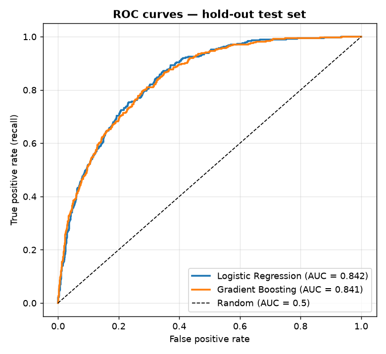
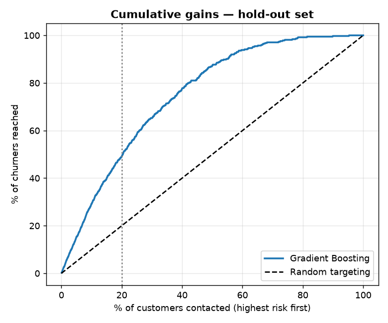
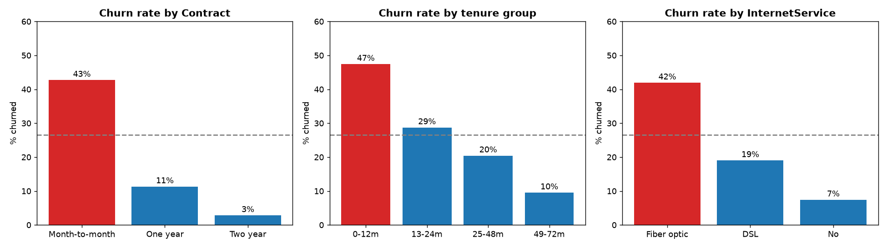
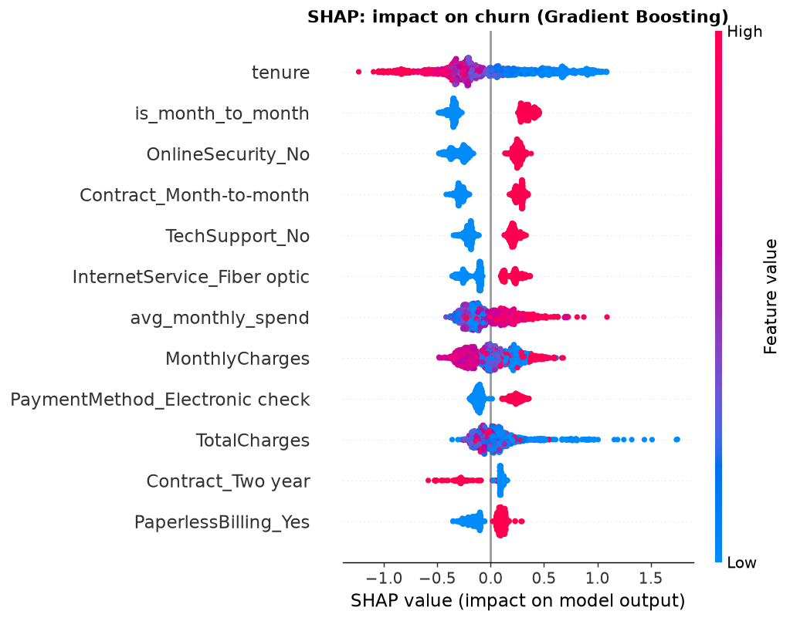

# Customer Churn Prediction — Telco

End-to-end machine-learning project that predicts which telecom customers are about to cancel, explains **why** with SHAP, and turns the model into a retention plan.


## Business problem
26.5% of customers in this dataset churned. Keeping a customer is usually far cheaper than winning a new one, so the business needs to (1) rank customers by churn risk and (2) understand what to fix.

## Dataset
[IBM Telco Customer Churn](https://github.com/IBM/telco-customer-churn-on-icp4d/blob/master/data/Telco-Customer-Churn.csv) — public sample from IBM: **7,043 customers × 21 columns** (demographics, services, contract, billing, `Churn`). Saved at `data/Telco-Customer-Churn.csv` and re-downloaded automatically if missing.

**Data cleaning:** `TotalCharges` is stored as text; 11 rows are blank — all customers with `tenure = 0` (not billed yet) — set to 0. No duplicate IDs.

## Approach
1. **EDA** — churn rate by contract, tenure, internet service, payment method, add-ons.
2. **Feature engineering** — `num_addon_services`, `tenure_group`, `avg_monthly_spend`, `is_month_to_month`, `auto_pay`.
3. **Models** — scikit-learn pipelines (`ColumnTransformer` + one-hot encoding): **Logistic Regression** (scaled) vs **Gradient Boosting**. Stratified 80/20 split, 5-fold stratified CV ROC-AUC on train for selection.
4. **Evaluation** — ROC-AUC, PR-AUC, precision/recall/F1, threshold trade-off, cumulative gains.
5. **Explainability** — SHAP (TreeExplainer) for Gradient Boosting + logistic-regression odds ratios.

## Results (hold-out test set, 1,409 customers)
| Model | CV ROC-AUC | Test ROC-AUC | Test PR-AUC | Precision@0.5 | Recall@0.5 | F1@0.5 |
|---|---:|---:|---:|---:|---:|---:|
| Logistic Regression | 0.846 ± 0.011 | **0.842** | 0.637 | 0.653 | 0.519 | 0.578 |
| Gradient Boosting | 0.847 ± 0.012 | 0.841 | **0.646** | 0.655 | 0.508 | 0.572 |

- **The two models are statistically tied** (difference far smaller than CV std). Gradient Boosting is kept for SHAP explanations; Logistic Regression is an equally good, simpler choice for production.
- At the default 0.5 threshold the model catches only ~51% of churners. **Lowering the threshold to 0.30 raises recall to 74%** (precision 52%, 37% of customers flagged) — see `outputs/threshold_tradeoff.csv`.
- **Targeting:** the 20% highest-risk customers contain **49% of all churners (2.4× lift)**; the top 40% contain 78%.

 

## What drives churn


| Segment | Churn rate |
|---|---:|
| Month-to-month vs 1-year vs 2-year contract | **42.7%** vs 11.3% vs 2.8% |
| Tenure 0–12 months vs 49–72 months | **47.4%** vs 9.5% |
| Fiber optic vs DSL internet | **41.9%** vs 19.0% |
| Electronic check vs automatic card payment | **45.3%** vs 15.2% |
| No tech support vs tech support | **41.6%** vs 15.2% |
| Senior citizens vs others | 41.7% vs 23.6% |



SHAP confirms **tenure** and **month-to-month contracts** as the two strongest drivers, followed by missing Online Security / Tech Support, fibre-optic service, monthly charges and electronic-check payment.

## Business recommendations
1. **Move month-to-month customers to annual plans** with a switching incentive — the single biggest lever.
2. **Onboarding programme for the first 12 months** (check-ins at months 1, 3, 6) — new customers churn ~5× more than long-tenure ones.
3. **Review fibre-optic price and quality** — highest-paying segment, ~42% churn.
4. **Bundle a free trial of Tech Support / Online Security** for at-risk customers.
5. **Encourage auto-pay** — electronic-check payers churn ~3× more than automatic payers.
6. **Score customers monthly** and give the top-risk 20% to the retention team (reaches ~half of churners).

## Repository structure
```
customer-churn-prediction/
├── data/Telco-Customer-Churn.csv
├── notebooks/churn_analysis.ipynb   # full analysis (executed, with outputs)
├── src/
│   ├── churn.py                     # loading, cleaning, features, model pipelines
│   └── train.py                     # script: CV + hold-out evaluation, saves best model
├── images/                          # charts used in this README
├── outputs/                         # model_comparison, threshold_tradeoff, shap_importance
├── requirements.txt
└── README.md
```

## How to run
```bash
pip install -r requirements.txt
python src/train.py                  # prints metrics, saves models/churn_model.joblib
python -m nbconvert --to notebook --execute --inplace notebooks/churn_analysis.ipynb
```

## Next steps
- Hyper-parameter tuning (Optuna) and calibrated probabilities.
- Cost-sensitive threshold using real retention-offer cost and customer lifetime value.
- Survival analysis (time-to-churn) instead of a yes/no label.
- Streamlit app for the retention team to score and filter customers.

## Author
**Pushpak Kumar Sahu** — [LinkedIn](https://linkedin.com/in/pushpak-kumar-sahu-2314593a6/) · p7050552704@gmail.com
